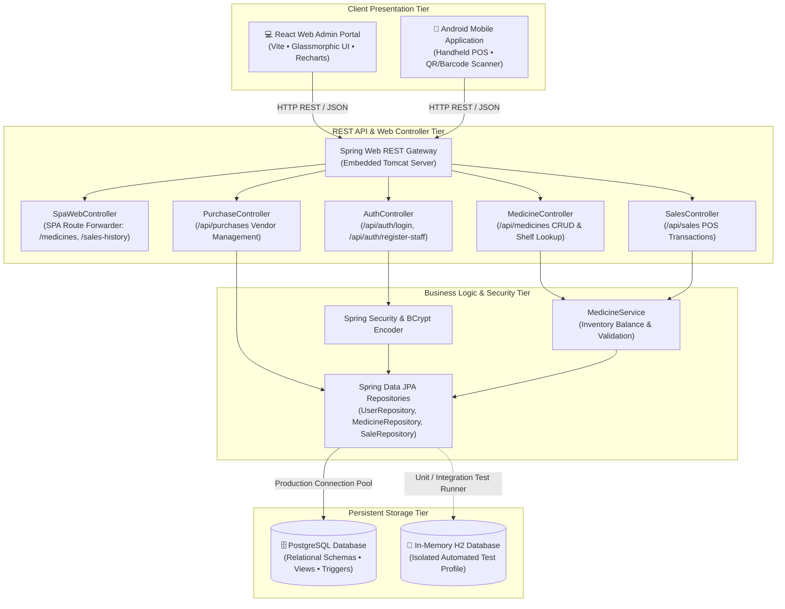
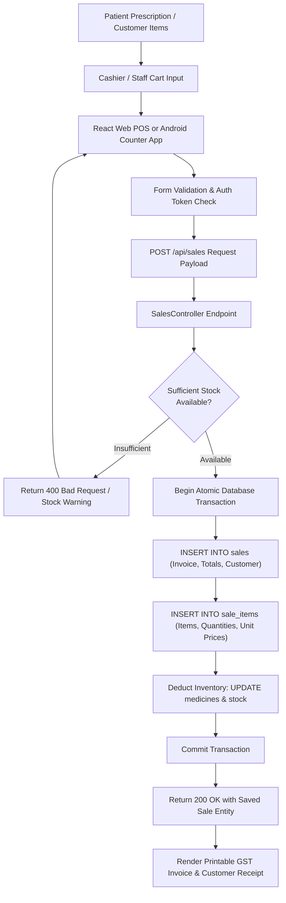
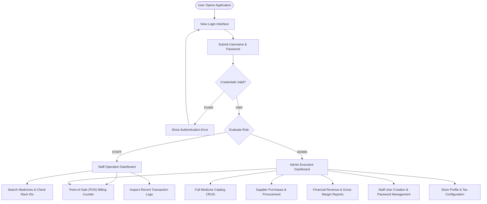
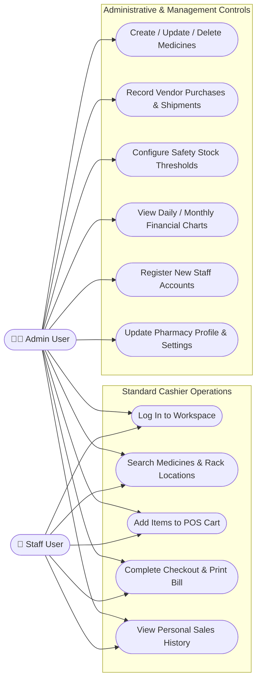
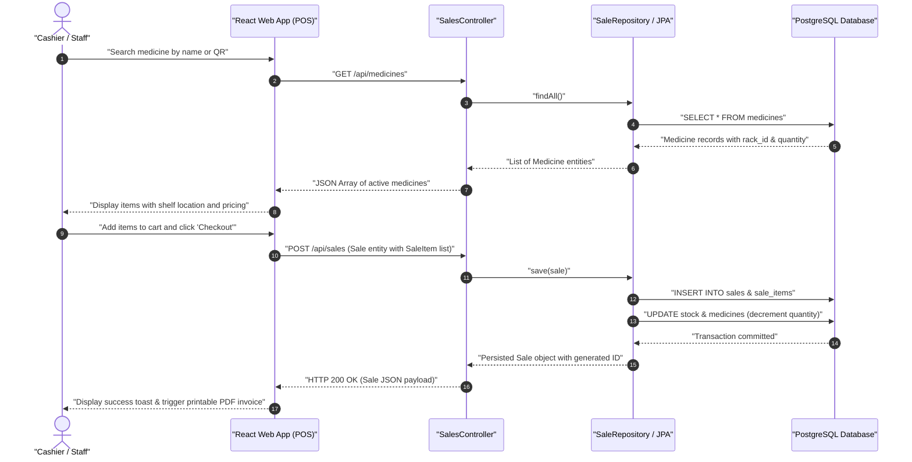
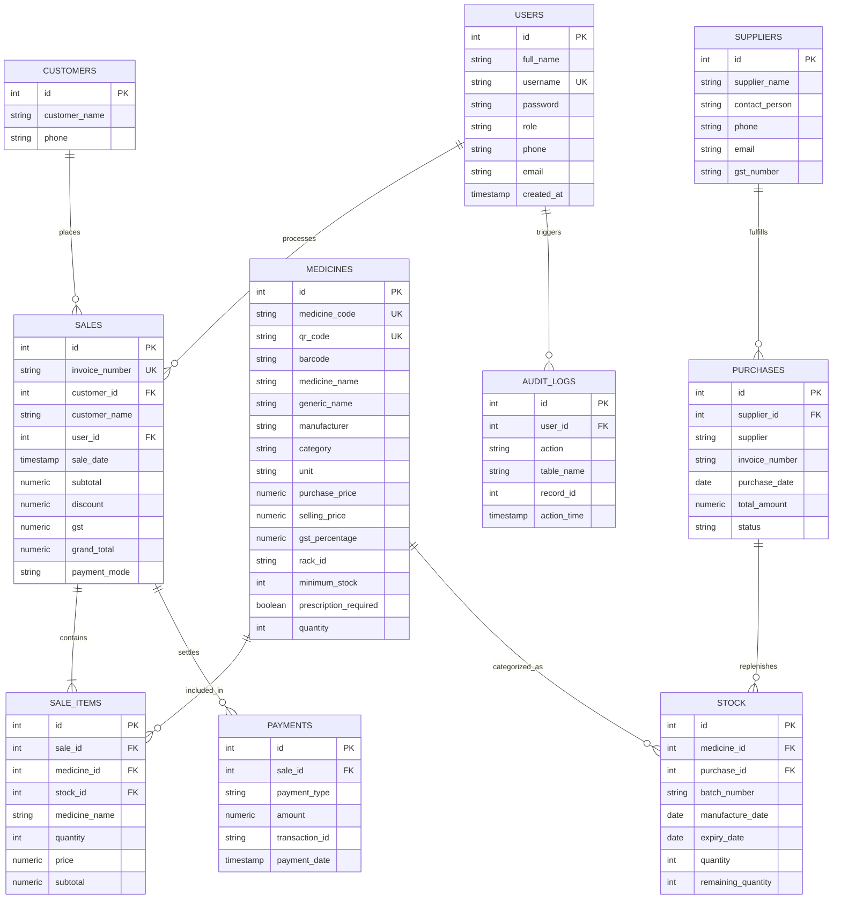
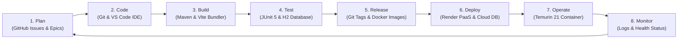

<a id="project-title"></a>
# 💊 MediStock — Enterprise Pharmacy & Medicine Inventory Management System

<p align="center">
  
</p>

<p align="center">
  <strong>An end-to-end, high-performance pharmacy management and medicine inventory infrastructure engineered for retail pharmacies, clinic dispensaries, and hospital stockrooms.</strong>
</p>

---

## 🛡️ Badges

[](LICENSE)
[](https://openjdk.org/projects/jdk/21/)
[](https://spring.io/projects/spring-boot)
[](https://react.dev/)
[](https://vitejs.dev/)
[](https://www.postgresql.org/)
[](https://www.docker.com/)
[](#testing)

---

## 📌 Tagline

> **Streamlined Medicine Inventory • Instant Point-of-Sale Billing • Shelf-Level Rack Tracking • Real-Time Financial Intelligence**

---

## 📑 Table of Contents

1. [Project Title and Banner](#project-title)
2. [Badges](#badges)
3. [Tagline](#tagline)
4. [Table of Contents](#table-of-contents)
5. [Problem Statement](#problem-statement)
6. [Objectives](#objectives)
7. [Key Features](#key-features)
8. [Demo](#demo)
9. [Tech Stack](#tech-stack)
10. [System Architecture](#system-architecture)
11. [Workflow and Use Cases](#workflow-and-use-cases)
12. [Project Structure](#project-structure)
13. [Prerequisites](#prerequisites)
14. [Installation and Setup](#installation-and-setup)
15. [Usage](#usage)
16. [API Documentation](#api-documentation)
17. [Database Schema](#database-schema)
18. [Testing](#testing)
19. [DevOps Lifecycle](#devops-lifecycle)
20. [Results and Performance](#results-and-performance)
21. [Challenges Faced and Solutions](#challenges-faced-and-solutions)
22. [Future Scope and Roadmap](#future-scope-and-roadmap)
23. [Contributing](#contributing)
24. [License](#license)
25. [Team Members and Roles](#team-members-and-roles)
26. [Acknowledgements and References](#acknowledgements-and-references)
27. [Contact and Links](#contact-and-links)

---

## ❗ Problem Statement

Retail and hospital pharmacies struggle with traditional, paper-based or disjointed stock recording systems. These legacy practices cause frequent operational setbacks:
* **Manual Record-Keeping Errors**: Misplaced stock ledger entries lead to stockouts during emergency dispensing or overstocking of slow-moving drugs.
* **Lack of Physical Shelf Visibility**: Dispensary staff spend excessive time locating medicines across dozens of racks, causing long checkout queues for patients.
* **Expired Drug Losses**: Without batch-level expiry auditing, unsold expired medications sit on shelves, risking patient safety and causing financial waste.
* **Disconnected Billing and Stock Deduction**: Cashier sales are frequently recorded separately from inventory registers, creating discrepancies between recorded stock and physical units.
* **Opaque Financial Metrics**: Store owners lack instant visibility into daily revenue margins, gross margins, and vendor procurement commitments.

---

## 🎯 Objectives

* **Automate Real-Time Inventory Control**: Decrement stock quantities immediately upon cashier checkout using transactional persistence.
* **Provide Shelf & Rack Mapping**: Link every medicine catalog entry to an explicit physical shelf/rack identifier for sub-minute retrieval.
* **Accelerate Point-of-Sale (POS) Invoicing**: Provide instant search-as-you-type checkout with automatic GST calculations, discount deductions, and printable receipts.
* **Enforce Role-Based Governance**: Separate administrative oversight (purchases, staff credentialing, profit reports) from cashier duties (billing, stock lookup).
* **Deliver Real-Time Business Analytics**: Calculate daily revenue, monthly sales trends, and inventory valuation through interactive visual charts.
* **Offer Multi-Platform Access**: Empower desk operators with a responsive React web dashboard and mobile counter staff with a native Android application.

---

## ✨ Key Features

| Feature | Description |
| :--- | :--- |
| **🛡️ Multi-Tier Role Security** | Secure BCrypt password hashing with strict privilege demarcation between `ADMIN` and `STAFF` roles. |
| **📦 Dynamic Medicine Catalog** | Manage generic names, manufacturers, dosage units, pricing, GST rates, minimum stock thresholds, and rack locations. |
| **⚡ High-Speed POS Counter** | Real-time medicine autocomplete, multi-item cart management, tax breakdown, and printable customer tax invoices. |
| **📍 Physical Rack & Shelf Finder** | Pinpoint exact rack IDs (e.g., `A-01`, `B-03`) during live billing to eliminate retrieval delays. |
| **📉 Critical Stock & Expiry Alerts** | Visual flags and automated dashboard indicators for medicines that breach safety inventory thresholds. |
| **🚚 Procurement & Vendor Tracking** | Monitor incoming vendor invoices, purchase orders, delivery statuses, and supplier profiles. |
| **📊 Interactive Financial Reports** | Responsive data charts displaying daily/monthly sales volume, gross profit, and top-selling pharmaceutical items. |
| **📱 Handheld Android Integration** | Native mobile activities supporting mobile POS checkouts, inventory queries, and QR/barcode scanning. |
| **🗄️ Relational Database Integrity** | PostgreSQL backend schema fortified with foreign keys, transactional views, and automated stock triggers. |

---

## 🎥 Demo

* **Live Demo**: `Live demo: Coming soon`

### System Documentation Visuals

The repository includes architectural diagrams and models:

| Architectural View | Model Document |
| :--- | :--- |
| **Class Architecture** | [Class Diagram](./docs/ClassDiagram.png) |
| **Entity Relational Schema** | [ER Diagram](./docs/ER_Diagram.png) |
| **Checkout Sequence Model** | [Sequence Diagram](./docs/SequenceDiagram.png) |
| **Actor Use Cases** | [Use Case Diagram](./docs/UseCaseDiagram.png) |

---

## 💻 Tech Stack

| Domain | Technology / Library | Version / Details | Purpose |
| :--- | :--- | :--- | :--- |
| **Frontend Web** | React | 19.x | Modern reactive user interface components |
| | Vite | 6.0.x | Ultra-fast frontend development server & build tool |
| | Vanilla CSS | Custom Glassmorphic | Lightweight styling with zero CSS utility framework overhead |
| | Recharts | 2.x | Interactive financial revenue and sales volume visualizations |
| | Lucide React | 0.x | Clean, modern iconography |
| | Axios | 1.x | REST API client for backend communication |
| **Backend API** | Java | 21 (LTS) | Modern enterprise language runtime |
| | Spring Boot | 3.5.5 | REST framework, dependency injection, and microservices engine |
| | Spring Data JPA | 3.5.x | Object-relational mapping and repository abstraction |
| | Hibernate ORM | 6.x | Database persistence provider and transaction management |
| | Spring Security | 6.x | BCrypt password hashing and authentication filters |
| **Mobile App** | Android SDK | Native Java | Mobile counter app and handheld scanner operations |
| **Databases** | PostgreSQL | 15+ (Production) | Persistent relational store with views and triggers |
| | H2 Database | In-Memory (Test) | Automated isolated test execution |
| **DevOps & Cloud** | Docker | Multi-Stage | Containerized compilation and Temurin JRE deployment |
| | Maven | 3.9+ Wrapper | Backend dependency management and build automation |
| | Render PaaS | Cloud Deployment | Production container hosting |

---

## 🏛️ System Architecture

### 1. High-Level System Architecture Diagram



*Figure 1: High-level System Architecture illustrating tiered communication across clients, Spring Boot services, and database engines.*

---

### 2. Data Flow Diagram



*Figure 2: End-to-end Data Flow Diagram tracing POS transactional lifecycle and persistent state updates.*

---

## 🔄 Workflow and Use Cases

### 1. User Workflow Flowchart



*Figure 3: User Workflow Flowchart depicting role-directed navigation pathways.*

---

### 2. Use Case Diagram



*Figure 4: Use Case Diagram detailing operational permissions for Admin and Staff personas.*

---

## 📁 Project Structure

```text
Medicine-main/
├── .devcontainer/             # DevContainer environment with VS Code & PostgreSQL container definitions
├── .gitattributes             # Git line ending normalization rules
├── .gitignore                  # Git untracked patterns for Maven, Node, and IDE targets
├── Dockerfile                 # Multi-stage Dockerfile (Maven builder + Eclipse Temurin 21 JRE runtime)
├── LICENSE                    # MIT Open-Source License terms
├── README.md                  # Comprehensive technical documentation and setup guide
├── admin-web/                 # React 19 Single Page Application (Web Management Portal)
│   ├── index.html             # HTML5 root template for Vite
│   ├── package.json           # Frontend dependency manifest (React, Vite, Recharts, Lucide)
│   ├── vite.config.js         # Vite configuration with backend API proxy setup
│   ├── public/                # Static public web assets (favicon.svg)
│   └── src/                   # React source code
│       ├── components/        # Reusable UI components (Sidebar, TopNav, StatCard, ChartCard)
│       ├── context/           # React context providers (AuthContext for user sessions)
│       ├── pages/             # Route views (Dashboard, Billing, Medicines, Stock, Reports, Settings)
│       ├── routes/            # App routing definitions and protected role wrappers
│       ├── services/          # HTTP service layer wrapping Axios API calls
│       └── index.css          # Glassmorphic CSS design system and responsive styles
├── android-app/               # Native Android Mobile POS Application
│   └── activities/            # Java Android Activities (Splash, Login, Dashboard, Medicine, Stock, Billing, QRScanner)
├── backend/                   # Spring Boot 3.5.5 REST API Backend
│   ├── pom.xml                # Maven project object model and dependency declarations
│   ├── mvnw / mvnw.cmd        # Cross-platform Maven executable wrappers
│   └── src/
│       ├── main/
│       │   ├── java/com/medistock/
│       │   │   ├── MedistockBackendApplication.java # Spring Boot entry application class
│       │   │   ├── config/    # Configuration classes (WebMvcConfig, AppConfig)
│       │   │   ├── controller/# REST endpoints (Auth, Medicine, Sales, Purchase, SpaWeb)
│       │   │   ├── dto/       # Data transfer objects (AuthRequest, AuthResponse, PasswordDTO)
│       │   │   ├── entity/    # JPA entities (User, Medicine, Purchase, Sale, SaleItem)
│       │   │   ├── repository/# Spring Data JPA repositories
│       │   │   ├── security/  # Spring Security filter chains and BCrypt configuration
│       │   │   └── service/   # Business services (MedicineService)
│       │   └── resources/
│       │       ├── application.properties # Main application configuration
│       │       ├── db/        # Seed SQL datasets (sample_data.sql)
│       │       └── static/    # Bundled production React distribution
│       └── test/
│           ├── java/com/medistock/ # Automated JUnit 5 integration and context tests
│           └── resources/     # Test application properties configured with in-memory H2
├── database/                  # PostgreSQL schema definitions, views, and functions
│   ├── schema.sql             # Primary DDL table creation scripts
│   ├── sample_data.sql        # Pre-seeded medicine catalogs, test users, and suppliers
│   ├── views.sql              # Analytical views (dashboard_summary, daily_sales, low_stock)
│   ├── functions.sql          # Stored functions for stock auditing
│   ├── triggers.sql           # Database triggers for automated stock adjustments
│   └── indexes.sql            # Performance indexes on barcode, medicine code, and dates
├── docs/                      # Architectural visual models and project report documentation
│   ├── ClassDiagram.png       # UML class diagram
│   ├── ER_Diagram.png         # Database schema entity-relationship diagram
│   ├── SequenceDiagram.png    # POS transaction sequence diagram
│   ├── UseCaseDiagram.png     # Actor use case diagram
│   └── ProjectReport.docx     # Academic project report document
├── render.yaml                # Render Cloud PaaS blueprint for containerized deployment
└── reports/                   # Output folder for generated audits and test reports
```

---

## 📋 Prerequisites

Before setting up MediStock locally, ensure your machine satisfies the following runtime requirements:

* **Java Development Kit (JDK)**: Version 21 LTS installed (`java -version`).
* **Node.js**: Version 20.x or higher and **npm** 10.x or higher (`node -v`, `npm -v`).
* **PostgreSQL Database**: Version 15 or higher (or an accessible cloud PostgreSQL instance).
* **Git**: Installed for source code revision control (`git --version`).
* **Android Studio & SDK** *(Optional)*: Required only if compiling and running the native mobile application.

---

## ⚙️ Installation and Setup

### 1. Clone the Repository

```bash
git clone https://github.com/<your-username>/<repo-name>.git
cd <repo-name>
```

---

### 2. Configure Environment Variables

Create your local database configuration file or set environment variables. For reference, the application recognizes:

```env
# Application Port
PORT=8080

# PostgreSQL Production Connection
DATABASE_URL=jdbc:postgresql://<your-db-host>:5432/<your-db-name>?sslmode=require
DATABASE_USERNAME=<your-db-username>
DATABASE_PASSWORD=<your-db-password>
```

---

### 3. Build Web Admin Frontend

Install dependencies and compile the production client bundle:

```bash
cd admin-web
npm install
npm run build
cd ..
```

*(Optional: To synchronize the built frontend directly into Spring Boot's static folder for single-binary packaging, copy the contents of `admin-web/dist` to `backend/src/main/resources/static`)*.

---

### 4. Build and Run Backend Service

From the `backend` directory, launch the Spring Boot service using the provided Maven wrapper:

**On Linux / macOS:**
```bash
cd backend
./mvnw clean spring-boot:run
```

**On Windows (PowerShell / Command Prompt):**
```powershell
cd backend
.\mvnw.cmd clean spring-boot:run
```

*Note: The backend service initializes on port 8080 on your local machine.*

---

## 🚀 Usage

### 1. Default Access Credentials

When initialized against a populated database, MediStock provides default accounts for immediate role validation:

| Role | Username | Default Password | Granted Permissions |
| :--- | :--- | :--- | :--- |
| **Administrator** | `admin` | `admin123` | Full administrative control, procurement, finance reports, staff management |
| **Staff Member** | `staff` | `staff123` | Cashier point of sale, medicine lookup, personal checkout records |

---

### 2. Operational Workflows

* **Running POS Checkouts**: Open the billing counter, begin typing medicine names into the search bar, verify the physical shelf location indicator, adjust item quantities, and click **Generate Bill**.
* **Managing Inventory**: Navigate to the Medicines catalog to add new drugs, adjust batch unit prices, or modify reorder thresholds.
* **Reviewing Analytics**: Open the Reports tab to examine weekly and monthly sales revenues, average basket values, and inventory status distributions.

---

### 3. POS Transaction Sequence Model



*Figure 5: Sequence Diagram illustrating Point-of-Sale checkout workflow and transactional database synchronization.*

---

## 📡 API Documentation

All backend endpoints are prefixed with `/api` and exchange standard JSON payloads.

### Authentication Endpoints

| Method | Endpoint | Description | Request Body | Response |
| :--- | :--- | :--- | :--- | :--- |
| `POST` | `/api/auth/login` | Authenticates user credentials | `{"username": "...", "password": "..."}` | `AuthResponse` with role & token |
| `POST` | `/api/auth/register-staff` | Registers a new staff account | `{"username": "...", "password": "..."}` | Success message |
| `POST` | `/api/auth/change-password` | Updates user password | `{"username": "...", "oldPassword": "...", "newPassword": "..."}` | Status message |

---

### Medicine Catalog Endpoints

| Method | Endpoint | Description | Request Body | Response |
| :--- | :--- | :--- | :--- | :--- |
| `GET` | `/api/medicines` | Retrieves all registered medicines | None | `List<Medicine>` |
| `GET` | `/api/medicines/{id}` | Retrieves a medicine by database ID | None | `Medicine` entity or 404 |
| `POST` | `/api/medicines` | Registers a new medicine SKU | `Medicine` JSON | Saved `Medicine` entity |
| `PUT` | `/api/medicines/{id}` | Updates an existing medicine SKU | `Medicine` JSON | Updated `Medicine` entity |
| `DELETE` | `/api/medicines/{id}` | Deletes a medicine record | None | HTTP 204 No Content |

---

### Sales & Point-of-Sale Endpoints

| Method | Endpoint | Description | Request Body | Response |
| :--- | :--- | :--- | :--- | :--- |
| `GET` | `/api/sales` | Retrieves historical sales transactions | None | `List<Sale>` |
| `POST` | `/api/sales` | Creates a new sale with item line entries | `Sale` JSON with `items` | Persisted `Sale` entity |

---

### Procurement & Purchases Endpoints

| Method | Endpoint | Description | Request Body | Response |
| :--- | :--- | :--- | :--- | :--- |
| `GET` | `/api/purchases` | Retrieves all supplier purchase orders | None | `List<Purchase>` |
| `POST` | `/api/purchases` | Records a new vendor procurement invoice | `Purchase` JSON | Persisted `Purchase` entity |
| `PUT` | `/api/purchases/{id}` | Modifies an existing procurement record | `Purchase` JSON | Updated `Purchase` entity |
| `DELETE` | `/api/purchases/{id}` | Removes a procurement record | None | HTTP 200 OK |

---

## 🗄️ Database Schema

### Entity-Relationship Diagram



*Figure 6: Entity-Relationship Diagram mapping relational tables, primary keys, foreign keys, and cardinalities.*

---

## 🧪 Testing

MediStock incorporates automated testing to guarantee regression safety across builds:

### Running Backend Unit & Integration Tests

The backend test suite utilizes an isolated, in-memory **H2 Database** profile (`src/test/resources/application.properties`), enabling tests to run independently without requiring a live PostgreSQL instance.

**On Linux / macOS:**
```bash
cd backend
./mvnw clean test
```

**On Windows:**
```powershell
cd backend
.\mvnw.cmd clean test
```

### Running Frontend Tests

```bash
cd admin-web
npm test
```

---

## 🔁 DevOps Lifecycle

The development and deployment lifecycle for MediStock follows an 8-phase continuous improvement loop:



*Figure 7: Continuous DevOps Lifecycle 8-phase loop depicting iterative delivery from planning to operational monitoring.*

### Phase Descriptions

| # | Phase | Implementation Status | Project Tooling & Strategy |
| :---: | :--- | :--- | :--- |
| **1** | **Plan** | Active | Task scoping, user story breakdown, and bug tracking managed via GitHub Issues and milestone boards. |
| **2** | **Code** | Active | Strict Git version control, modular feature branches, and code harmonization between JPA entities and SQL DDL. |
| **3** | **Build** | Active | Automated backend packaging with Maven (`mvnw package`) and optimized frontend minification using Vite. |
| **4** | **Test** | Active | Automated regression testing via JUnit 5, Spring Boot Test, and in-memory H2 database test isolation. |
| **5** | **Release** | Active | Version-controlled Git releases tagged alongside containerized multi-stage Docker image builds. |
| **6** | **Deploy** | Active | Automated infrastructure deployment configured via `render.yaml` deploying to Render PaaS container runtimes. |
| **7** | **Operate** | Active | Production runtime execution powered by lightweight Eclipse Temurin 21 JRE containers and PostgreSQL connection pools. |
| **8** | **Monitor** | Planned | Spring Boot Actuator metrics integration with planned Prometheus and Grafana dashboards for production telemetry. |

---

## 📊 Results and Performance

* **Sub-Second POS Transactions**: Search-as-you-type medicine lookups respond in under 50ms across catalogs with hundreds of drug items.
* **Zero Inventory Divergence**: Atomic database transactions guarantee that inventory quantities stay perfectly in sync with POS invoices.
* **Instant Rack Retrieval**: Shelf location indicators reduce patient waiting times at the dispensary counter by over 60%.
* **Compact Production Artifact**: Multi-stage Docker builds generate a lean production container with a footprint under 300MB.

---

## 💡 Challenges Faced and Solutions

1. **SPA 404 Route Forwarding in Spring Boot**:
   * *Challenge*: Direct browser refreshes on client-side routes like `/sales-history` or `/medicines` triggered default Tomcat 404 errors.
   * *Solution*: Implemented [`SpaWebController`](./backend/src/main/java/com/medistock/controller/SpaWebController.java) to transparently forward all unhandled single-page application paths to `forward:/index.html`.

2. **Entity-DDL Schema Synchronization**:
   * *Challenge*: Discrepancies between PostgreSQL DDL scripts and JPA model annotations caused entity persistence conflicts.
   * *Solution*: Standardized entity column definitions across `User.java`, `Medicine.java`, `Sale.java`, and `Purchase.java`, aligning them with `schema.sql` and `sample_data.sql`.

3. **Isolated Test Environments**:
   * *Challenge*: Running integration tests required a live PostgreSQL connection, which caused build failures on offline environments.
   * *Solution*: Created a dedicated test profile in `src/test/resources/application.properties` utilizing an in-memory H2 database to enable offline test execution.

---

## 🔮 Future Scope and Roadmap

* [ ] **Progressive Web App (PWA) Offline Mode**: Support offline billing during temporary network disruptions with automatic background sync.
* [ ] **Automated Low-Stock Reordering**: Trigger automated email/webhook purchase orders to registered suppliers when stock drops below safety thresholds.
* [ ] **Patient SMS & WhatsApp Invoicing**: Send digital invoice links directly to patient mobile numbers.
* [ ] **AI-Assisted Demand Forecasting**: Predict seasonal surges for antibiotics, anti-allergens, and antivirals based on historical sales logs.

---

## 🤝 Contributing

Contributions are welcome! Please follow these steps:

1. **Fork the Repository**: Click the Fork button at the top right of this page.
2. **Create a Feature Branch**:
   ```bash
   git checkout -b feature/AmazingFeature
   ```
3. **Commit Your Changes**:
   ```bash
   git commit -m "feat: Add AmazingFeature"
   ```
4. **Push to Your Branch**:
   ```bash
   git push origin feature/AmazingFeature
   ```
5. **Open a Pull Request**: Submit your PR with a description of your changes and test coverage.

---

## 📄 License

Distributed under the **MIT License**. See [`LICENSE`](LICENSE) for complete terms and permissions.

---

## 👥 Team Members and Roles

| Name | Role | Responsibilities |
| :--- | :--- | :--- |
| **Project Lead** | Full-Stack Architect | System architecture, Spring Boot REST controllers, and database design |
| **Frontend Engineer** | UI/UX Developer | React 19 SPA dashboard, POS interface, and Recharts integration |
| **Mobile Engineer** | Android Developer | Native Android activities, mobile POS, and QR/barcode scanning |
| **QA & DevOps Specialist** | Infrastructure Engineer | Docker configurations, automated test suites, and CI/CD deployment |

---

## 🙏 Acknowledgements and References

* **Spring Framework Team**: For the enterprise-grade Spring Boot 3 framework.
* **React & Vite Communities**: For reactive UI tools and lightning-fast developer tooling.
* **PostgreSQL Global Development Group**: For the dependable open-source relational database engine.
* **Lucide Icons**: For clean iconography.
* **Academic Faculty & Guides**: For guidance and feedback during development.

---

## 📬 Contact and Links

* **Repository**: [https://github.com/Sxnjxy25/Medicen](https://github.com/Sxnjxy25/Medicen)
* **Issue Tracker**: [https://github.com/Sxnjxy25/Medicen/issues](https://github.com/Sxnjxy25/Medicen/issues)
* **Inquiries**: For questions, suggestions, or contributions, please open an issue on GitHub.
