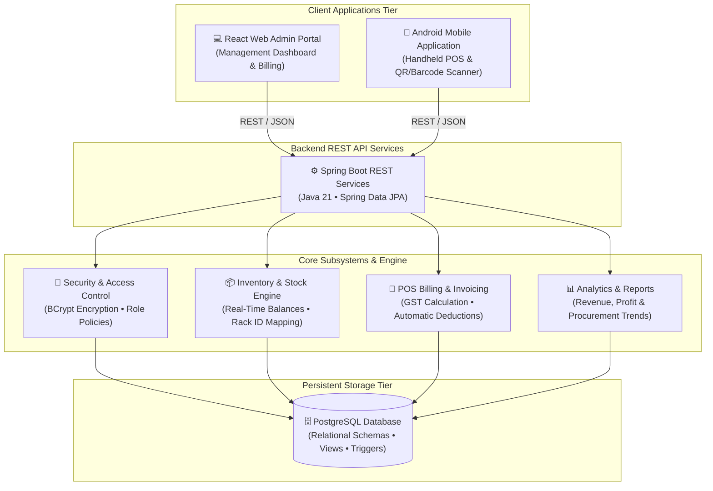

# 💊 MediStock — Enterprise Pharmacy & Stock Management Infrastructure

> **Intelligent Inventory Tracking • POS Invoicing • Multi-Tier Role Governance • Real-Time Stock Analytics**

MediStock is a modern, enterprise-ready pharmacy and medicine inventory management platform designed for pharmacies, clinics, and hospital dispensing counters. The system unifies high-throughput Point-of-Sale (POS) transactions, automated stock level deductions, batch and rack tracking, and executive analytics into a single responsive operational cockpit.

---

## 🏛️ System Architecture



---

## 🌟 Core System Capabilities

### 1. 🛡️ Role-Based Access Governance
* **Administrator**: Full system visibility, procurement management, comprehensive revenue and profit reports, and staff account management (create, password reset, decommission).
* **Staff**: Focused Point-of-Sale billing and inventory search; restricted from modifying store configuration or accessing financial auditing data.

### 2. ⚡ Real-Time Stock & Rack Management
* Instant deduction of medicine stock upon POS bill completion.
* Detailed medicine metadata including Generic Name, Manufacturer, Unit type (Tablet, Capsule, Syrup, Injection), Minimum Stock threshold, and Physical Rack ID for rapid shelf retrieval.
* Automatic low-stock warnings and critical inventory alerts.

### 3. 🧾 Point-of-Sale (POS) Billing & Tax Invoicing
* Fast search-as-you-type medicine autocomplete with live shelf/rack indicators.
* Automatic GST computation and subtotal accounting.
* Single-click invoice generation with direct print and PDF export capabilities.

### 4. 📈 Business Intelligence & Audit Reports
* Dynamic revenue, operating expense, and net profit metrics.
* Filterable timeframes (Weekly and Monthly trends) with interactive visual charts.
* Procurement tracking with supplier profiles, order records, and delivery status tracking.

### 5. 📱 Handheld Mobile POS & Barcode Scanner
* Dedicated Android application modules for handheld operations.
* QR code and barcode scanning support for rapid bedside or counter product identification.
* Local session authentication with automatic synchronization to the central backend.

---

## 🧭 Application Overview

| Module | Access Role | Description |
| :--- | :--- | :--- |
| **Dashboard** | Admin & Staff | High-level metrics: total medicines, low stock alerts, and daily sales trends. |
| **Medicines** | Admin & Staff | Master medicine catalog with search, filter, creation, and editing tools. |
| **Stock Management** | Admin & Staff | SKU stock levels, minimum quantity thresholds, and adequacy monitors. |
| **Billing (POS)** | Admin & Staff | Checkout counter for adding medicines, calculating tax, and issuing receipts. |
| **Sales History** | Admin & Staff | Historical invoice log with item-level breakdowns and audit details. |
| **Purchase History**| Admin Only | Procurement logs, supplier management, and incoming shipment status. |
| **Reports** | Admin Only | Financial analytics, top-selling medicines, and print-ready executive summaries. |
| **Settings** | Admin Only | Store profile configuration, pharmacy license details, and staff credentials. |

---

## 🛠️ Technology Stack

* **Backend Platform**: Spring Boot 3.5, Java 21, Spring Data JPA, Spring Security, Hibernate ORM
* **Frontend Web**: React 19, Vite, Vanilla CSS, Recharts, Lucide Icons
* **Mobile Application**: Android SDK (Java), Native Activities (POS, Stock, QR Scanner)
* **Database Engine**: PostgreSQL (Production), H2 Database (Test Isolation)
* **Containerization**: Docker Multi-Stage Build

---

## ⚡ Getting Started

### Prerequisites
* **Java Development Kit (JDK) 21**
* **Node.js 20+** and **npm**
* **PostgreSQL Database**

### 1. Compile Web Frontend
Compile the React admin portal assets:
```bash
cd admin-web
npm install
npm run build
```

### 2. Launch Backend Service
From the backend directory, run the Spring Boot service:
```bash
cd backend
./mvnw spring-boot:run
```
*(On Windows systems, use `.\mvnw.cmd spring-boot:run`)*

### 3. Default Credentials
The system automatically boots with pre-configured default accounts upon first initialization:

* **Administrator**: `admin` / `admin123`
* **Staff**: `staff` / `staff123`

---

## 📄 License
Distributed under the MIT License.
